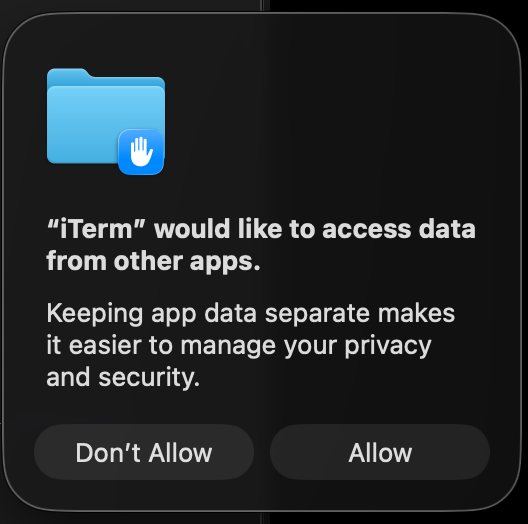

# Agent Framework exposure check

Check a Windows or Mac computer for signs of the compromised
`agent-framework` versions **1.26.1 and 1.26.2**.

## 1. Extract the ZIP

[Download AgentFramework-QuickScan.zip](https://github.com/memasanz/agent-framework-exposure-check/releases/latest/download/AgentFramework-QuickScan.zip)
and extract it:

- **Windows:** right-click the ZIP and choose **Extract All**.
- **Mac:** double-click the ZIP.

Open the extracted folder. **Do not run files from inside the ZIP.**
You can extract it anywhere; keep all the files together.

## 2. Double-click a scan

**Start with Quick.**

| Your computer | Quick scan | Full scan |
| --- | --- | --- |
| Windows | `Run-QuickScan.cmd` | `Run-FullScan.cmd` |
| Mac | `Run-QuickScan.command` | `Run-FullScan.command` |

**Mac launch permissions (one-time, if needed):** Open Terminal and type
`chmod u+x `, including the space at the end. Drag both `.command` files
from the extracted folder into Terminal, then press Return. This gives
those files permission to run. You can then double-click them normally.
It does not bypass Gatekeeper or your organization's security controls.

**Quick** looks for suspicious filenames in your user-profile/home folder.
**Full** also checks package information, dependency files, and cached
packages across a broader area: local fixed drives on Windows, or the main
data volume on Mac. Other mounted Mac volumes are not included.

Full scans ask you to confirm: press **Y** on Windows, or type **FULL** and
press Return on Mac. They can take much longer than Quick scans.
Leave the scan window open until the result appears.

**Windows access warnings:** The scanner checks access before searching.
If folders are blocked or cloud files are unavailable, ask IT to review
the gaps and rerun after approved changes. It never changes permissions,
downloads cloud placeholders, or elevates automatically.

### Mac privacy prompt

During the scan, macOS may ask whether **iTerm** or **Terminal** can
**"access data from other apps"**, as shown below. The app name may differ.

This permission applies to the terminal app, not just this scan. Choose
**Allow only if your IT/security team has approved that access**. If you choose
**Don't Allow**, the scan may continue with some folders inaccessible;
review the report's errors and skipped locations. Do not change privacy
settings or bypass security controls without IT approval.

The scanner checks access before searching. If macOS blocks folders, ask IT
to review **System Settings > Privacy & Security > Files & Folders / Full Disk
Access** for the terminal app opening the launcher, then rerun after approved
changes. The script never changes permissions.

## 3. Open your report

The window shows where the reports were saved in your user-profile/home
folder. Each run creates two matching files:

- **`.html`**: double-click this to read the results in your browser.
- **`.json`**: keep this for your security/IT team.

Quick reports start with `AgentFramework-QuickReport-`.
Full reports start with `AgentFramework-FullReport-`.
Each run gets a new name, so earlier reports are not overwritten.

| Report status | What it means |
| --- | --- |
| `IndicatorsFound` | Something needs investigation. Contact your security/IT team. |
| `Incomplete` | Some locations could not be checked. Ask your security/IT team to review the gaps. |
| `NoIndicatorsInScannedScope` | Nothing matched in the locations checked. This does **not** prove the computer is safe. |

Both platforms also show **Coverage** separately, including when indicators are
found. Repetitive diagnostics and example skipped links are collapsed in HTML;
the JSON retains every diagnostic and skipped path. Skipped links still mean
incomplete coverage, not that those targets are safe. Windows executable
aliases are retained separately in the JSON detail, not treated as missing
package-file coverage; directory links and cloud folders still count as gaps.

If anything is flagged, **do not delete the files or start Python/pip in the
suspect environment**. Send both reports to your security/IT contact through
your approved process. Reports can contain internal paths and computer names.

## Before you run

- No Python installation is needed. The scanner does not start Python,
  delete inspected files, or upload results.
- Use your normal account. Obtain IT approval before a Full scan; do not
  run as administrator or use `sudo` unless IT approves.
- If your computer blocks a launcher, contact IT. Do not disable security
  controls to make it run.
- **Mac rollout:** native macOS double-click launching still needs an IT
  smoke test before broad distribution.

Advanced commands, coverage limits, and security-team guidance are in the
[technical guide](TECHNICAL-GUIDE.md). The incident is described in
[GHSA-764m-3ppc-5m73](https://github.com/advisories/GHSA-764m-3ppc-5m73).
